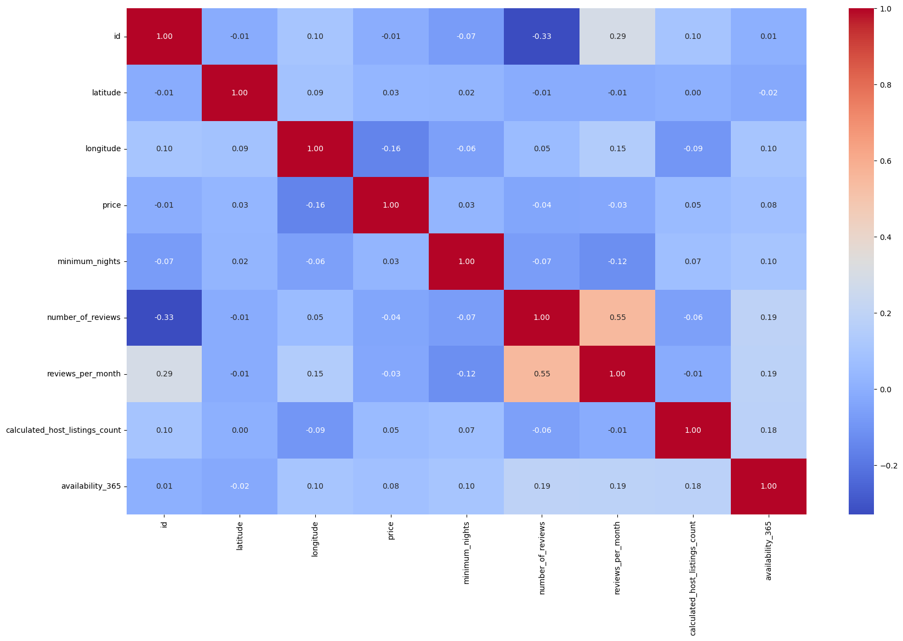
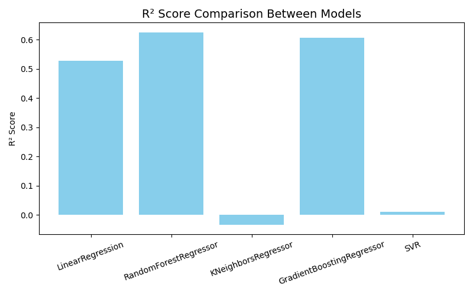

# Airbnb Price Analysis & Prediction

An end-to-end data science project that analyzes New York City Airbnb listings and builds machine learning models to predict listing prices.

## Project Objective

Airbnb prices vary based on location, room type, availability, reviews, and other listing characteristics. This project aims to:

- Explore the factors associated with listing prices
- Identify patterns across New York City boroughs and room types
- Prepare categorical and numerical data for machine learning
- Train and compare regression models
- Evaluate model performance using regression metrics

## Dataset

The project uses the **AB_NYC_2019** dataset, which contains **48,895 listings** and 16 original features.

Important fields include location, room type, price, minimum nights, reviews, host listing count, and annual availability.

## Project Workflow

1. Load and inspect the dataset
2. Check missing values and duplicate records
3. Remove identifiers and non-predictive columns
4. Explore distributions and relationships between variables
5. Encode categorical features
6. Split the data into training and testing sets
7. Train multiple regression models
8. Compare their predictive performance

## Visual Analysis

### Dataset Overview


### Correlation Matrix



### Model Comparison



## Models and Results

Five regression algorithms were trained and compared on the same data.

- **Split:** 70% training / 30% testing (`test_size=0.3`, `random_state=42`)
- **Target:** `log1p(price)`, so MAE and RMSE below are on the log scale, not in dollars
- **Settings:** scikit-learn default settings, except KNN (`n_neighbors=15`). Features were not scaled.

| Algorithm | Type | MAE | RMSE | R² |
|---|---|---|---|---|
| Linear Regression | Linear model | 0.338 | 0.455 | 0.527 |
| **Random Forest Regressor** | Ensemble (many decision trees, averaged) | **0.293** | **0.405** | **0.625** |
| Gradient Boosting Regressor | Ensemble (decision trees built one after another) | 0.304 | 0.415 | 0.606 |
| K-Nearest Neighbors (k=15) | Distance-based | 0.530 | 0.672 | -0.033 |
| Support Vector Regression (SVR) | Support vector machine | 0.522 | 0.658 | 0.010 |

**Best model:** Random Forest, with an R² of 0.625 on the test set and the lowest errors. Gradient Boosting was close behind (R² 0.606), and Linear Regression reached 0.527. KNN and SVR performed poorly on this data.

## Tools & Technologies

- Python
- Jupyter Notebook
- Pandas and NumPy
- Matplotlib and Seaborn
- scikit-learn

## Repository Structure

```text
.
├── AB_NYC_2019.csv
├── airbnb1.ipynb
├── correlation_matrix.png
├── regression_r2_barplot.png
├── output1.png ... output10.png
└── README.md
```

## How to Run

```bash
git clone https://github.com/arif-almusharafi/airbnb-price-analysis-and-prediction.git
cd airbnb-price-analysis-and-prediction
pip install pandas numpy matplotlib seaborn scikit-learn jupyter
jupyter notebook airbnb1.ipynb
```

Keep `AB_NYC_2019.csv` in the repository root and run the notebook cells in order.

## Skills Demonstrated

- Exploratory data analysis
- Data cleaning and preprocessing
- Categorical feature encoding
- Regression modeling
- Model evaluation and comparison
- Data visualization

## Author

**Arif Al-Musharafi** — Artificial Intelligence graduate interested in machine learning, computer vision, data science, and software development.

[LinkedIn](https://www.linkedin.com/in/arif-almishrafi-45612b2a7) · [GitHub](https://github.com/arif-almusharafi)
