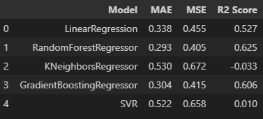

# Airbnb Price Analysis & Prediction

An end-to-end data science project that analyzes New York City Airbnb listings and builds machine learning models to predict listing prices.

## Live Demo

- **Project page:** https://arif-almusharafi.github.io/airbnb-price-analysis-and-prediction/ (GitHub Pages, served from the `docs/` folder)
- **Price prediction API:** the URL is added here after the API is deployed on Render. Steps are in [backend/README.md](backend/README.md).

The project page explains the work and has a live price predictor. The API runs on a free server that sleeps when idle, so the first prediction can take about a minute.

## Project Objective

Airbnb prices vary based on location, room type, availability, reviews, and other listing characteristics. This project aims to:

- Explore the factors associated with listing prices
- Identify patterns across New York City boroughs and room types
- Prepare categorical and numerical data for machine learning
- Train and compare regression models
- Evaluate model performance using regression metrics

## Dataset

The project uses the **AB_NYC_2019** dataset, which contains **48,895 listings** and 16 original features.

Important fields include location, room type, price, minimum nights, reviews, host listing count, and annual availability.

## Project Workflow

1. Load and inspect the dataset
2. Check missing values and duplicate records
3. Remove identifiers and non-predictive columns
4. Explore distributions and relationships between variables
5. Encode categorical features
6. Split the data into training and testing sets
7. Train multiple regression models
8. Compare their predictive performance

## Visual Analysis

### Dataset Overview



### Correlation Matrix


### Model Comparison


## Models and Results

Five regression algorithms were trained and compared on the same data.

- **Split:** 70% training / 30% testing (`test_size=0.3`, `random_state=42`): 27,164 training rows and 11,642 testing rows
- **Target:** `log1p(price)`, so MAE and RMSE below are on the log scale, not in dollars
- **Settings:** tuned with 3-fold cross-validation (`GridSearchCV`) on the training set only. The test set was not used to choose settings. KNN and SVR now use `StandardScaler`.

### Two bug fixes

- **Outlier filter:** the outlier list holds row index numbers, but it was compared with the `id` column, so no rows were removed. It now filters by index and removes the 15 chosen rows (38,821 to 38,806 rows).
- **Listing id as a feature:** `id` was left in the model inputs. It is now dropped, because it is not real listing information and a user cannot enter it.

The RMSE line also changed from `mean_squared_error(..., squared=False)` to `np.sqrt(mean_squared_error(...))`, because newer scikit-learn versions removed `squared`.

### R² in three stages

| Algorithm | Original | After bug fixes | Tuned |
|---|---|---|---|
| Linear Regression | 0.527 | 0.516 | 0.516 |
| **Random Forest Regressor** | 0.625 | 0.614 | **0.628** |
| Gradient Boosting Regressor | 0.606 | 0.600 | 0.620 |
| K-Nearest Neighbors | -0.033 | 0.212 | 0.602 |
| Support Vector Regression (SVR) | 0.010 | 0.284 | 0.595 |

- **Original:** the first version of the notebook.
- **After bug fixes:** same settings, fixed data. Linear Regression, Random Forest, and Gradient Boosting dropped slightly without `id`.
- **Tuned:** fixed data with the new settings below.

### Final results (tuned)

| Algorithm | Type | Settings | MAE | RMSE | R² |
|---|---|---|---|---|---|
| Linear Regression | Linear model | default | 0.342 | 0.464 | 0.516 |
| **Random Forest Regressor** | Ensemble (many decision trees, averaged) | `n_estimators=300, min_samples_leaf=2, max_features=0.33` | **0.294** | **0.407** | **0.628** |
| Gradient Boosting Regressor | Ensemble (decision trees built one after another) | `n_estimators=300, learning_rate=0.05, max_depth=5` | 0.298 | 0.412 | 0.620 |
| K-Nearest Neighbors | Distance-based | scaled, `n_neighbors=40, weights="distance"` | 0.307 | 0.421 | 0.602 |
| Support Vector Regression (SVR) | Support vector machine | scaled, `C=10, epsilon=0.2` | 0.305 | 0.425 | 0.595 |

**Best model:** Random Forest, with an R² of 0.628 on the test set and the lowest errors, slightly above the original 0.625 even without `id`. Gradient Boosting was close behind (R² 0.620). Scaling helped KNN and SVR the most: they went from near 0 to about 0.60.

**Live predictor model:** the API uses the tuned Gradient Boosting model (R² 0.620, average error about $48 per night on the test set). Random Forest scores slightly higher, but its model file is 93 MB and needs about 480 MB of memory. Gradient Boosting is under 1 MB and fits free hosting (512 MB). Predictions are estimates based on 2019 data.

## Price Prediction API

A small FastAPI service in `backend/` loads the trained model and returns a predicted nightly price in dollars (`GET /api/health`, `POST /api/predict`).
To run it: install `backend/requirements.txt` in a virtual environment, then start it with `uvicorn`. See [backend/README.md](backend/README.md) for the exact steps, tests, and how to retrain the model.

## Tools & Technologies

- Python
- Jupyter Notebook
- Pandas and NumPy
- Matplotlib and Seaborn
- scikit-learn
- FastAPI (prediction API)
- HTML, CSS, and JavaScript (project page)

## Repository Structure

```text
.
├── AB_NYC_2019.csv
├── airbnb1.ipynb
├── correlation_matrix.png
├── regression_r2_barplot.png
├── output1.png ... output10.png
├── README.md
├── backend/      # Price prediction API (FastAPI), training script, tests
└── docs/         # Project page (GitHub Pages)
```

## How to Run

```bash
git clone https://github.com/arif-almusharafi/airbnb-price-analysis-and-prediction.git
cd airbnb-price-analysis-and-prediction
pip install pandas numpy matplotlib seaborn scikit-learn folium jupyter
jupyter notebook airbnb1.ipynb
```

Keep `AB_NYC_2019.csv` in the repository root and run the notebook cells in order.

The notebook works with new scikit-learn versions: the `squared=False` argument is no longer used. It was last run with scikit-learn 1.9.1 (the version in `backend/requirements.txt`).

## Skills Demonstrated

- Exploratory data analysis
- Data cleaning and preprocessing
- Categorical feature encoding
- Regression modeling
- Hyperparameter tuning with cross-validation
- Model evaluation and comparison
- Data visualization
- Serving a model with a REST API

## Author

**Arif Al-Musharafi** — Artificial Intelligence graduate interested in machine learning, computer vision, data science, and software development.

[LinkedIn](https://www.linkedin.com/in/arif-almishrafi-45612b2a7) · [GitHub](https://github.com/arif-almusharafi)
